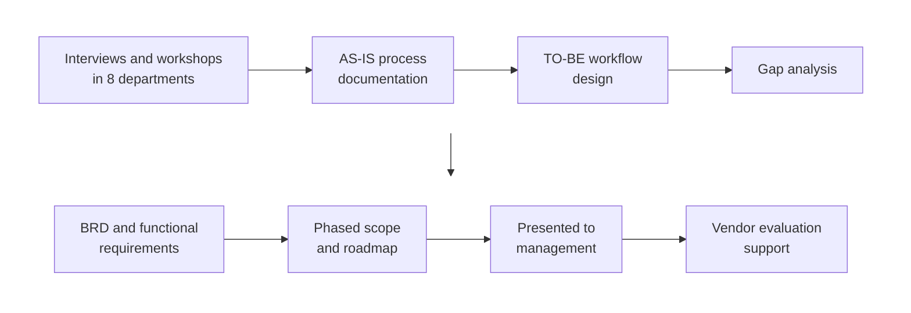
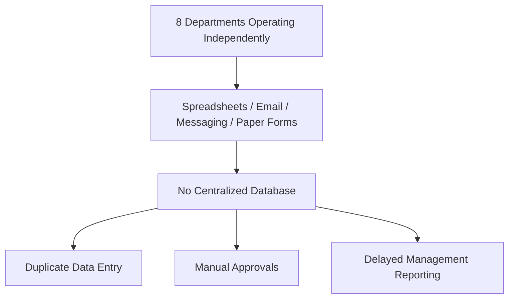
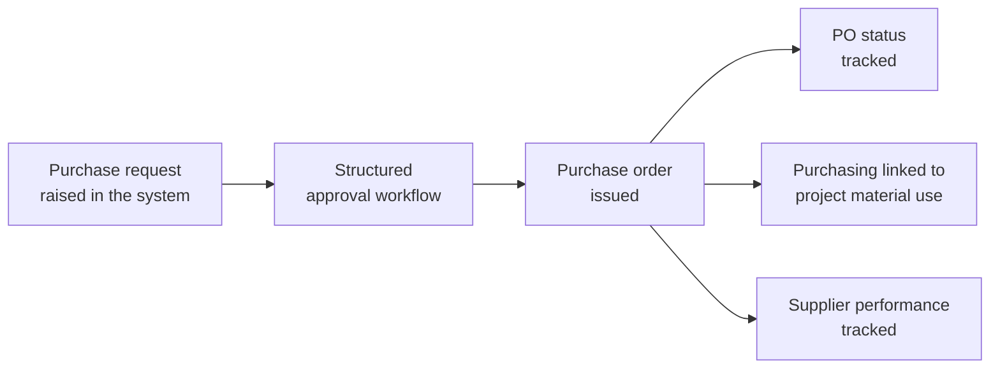

# ERP Readiness Assessment: Construction & Transportation

**Case study** · Construction and transportation company, Saudi Arabia (my current employer) · Nov 2025 – Present · Role: Senior ERP Business Analyst

This is the full write-up behind the [README](../README.md). It covers the company's starting point, what I found in each of the 8 departments, the phased scope I recommended, and where the work stands. The requirements by department are in the [BRD](BRD.md).

## The company

The company is newly established and works in construction (residential, government, and airport and infrastructure projects) and transportation (specialized transport, intercity buses, and urban rail passenger services). It is growing and preparing to run several projects at the same time, and it had not yet adopted an ERP. Departments relied on spreadsheets, email, messaging, paper forms, and shared folders, with no shared business database. Management asked for an assessment before choosing an ERP platform.

## My role

The assessment was for my own employer, not an external client. I represented the business side throughout: I interviewed stakeholders, ran requirements workshops, documented the AS-IS processes, designed the TO-BE workflows, performed the gap analysis, wrote the BRD and the functional requirements, recommended the ERP modules and their order, supported vendor evaluation, and presented the findings to management.

## What I found in each department

| Department | Current-state findings |
|---|---|
| Executive Management | No executive dashboards; limited visibility of finances, project profitability, cash flow, and portfolio performance |
| Finance | Heavy use of Excel, manual journal entries, late financial reporting, limited project cost visibility, manual budget tracking |
| Procurement | Purchase requests by email or paper, no structured approval workflow, little supplier performance tracking, hard to follow PO status |
| Projects | Project costs tracked by hand, no central budget monitoring, limited progress visibility, hard to compare budget with actual, late reporting |
| Warehouse & Materials | Manual material requests, limited view of availability, late receipt and issue recording, hard to track consumption by project, weak link between procurement and project use |
| Equipment & Plant | Manual equipment allocation, no central maintenance schedule, limited availability view, hard to track utilization across projects |
| Transportation Operations | Manual vehicle scheduling, fuel tracked separately, separate maintenance records, driver scheduling not linked to operations |
| Human Resources | Manual employee records, leave requests outside a central system, separate attendance tracking, manual payroll reconciliation |

Across departments the same issues kept appearing: data entered more than once, manual approvals everywhere, limited project cost visibility, a weak link between purchasing and project material use, late management reporting, few operational dashboards, processes that differed from one function to another, and a heavy dependence on spreadsheets.

## A representative TO-BE process: procurement

Procurement shows how a finding became a future-state process. At the time of the assessment, purchase requests traveled by email or paper, there was no structured approval workflow, and PO status was hard to follow. The BRD turns that into a system-based flow:

This is a representative flow built from the BRD requirements (BR-PROC-01 to 03, CC-03, CC-04). Approval levels are not defined at this stage.

## Recommended scope

I recommended implementing the ERP in three phases, set out as a high-level roadmap. Finance, procurement, and project cost control come first, because that is where the gaps were sharpest. People and asset management follow, and executive analytics come last.

| Phase | Areas |
|---|---|
| 1 | Finance, Procurement, Projects, Material Management, Document Management, Approval Workflows |
| 2 | Human Resources, Payroll, Equipment Maintenance, Fleet Management |
| 3 | Executive Dashboards, Business Intelligence, Mobile Access, Vendor Portal |

```mermaid
flowchart LR
    subgraph Phase1[Phase 1]
        F1[Finance]
        P1[Procurement]
        PR1[Projects]
        M1[Material Management]
        D1[Document Management]
        A1[Approval Workflows]
    end
    subgraph Phase2[Phase 2]
        HR2[Human Resources]
        PAY2[Payroll]
        EQ2[Equipment Maintenance]
        FL2[Fleet Management]
    end
    subgraph Phase3[Phase 3]
        BI3[Executive Dashboards / BI]
        MOB3[Mobile Access]
        VP3[Vendor Portal]
    end
    Phase1 --> Phase2 --> Phase3
```

A sample of how findings turned into recommended capabilities:

| Department | Current state | Recommended capability |
|---|---|---|
| Finance | Manual journal entries, late reporting | Central financial module with real-time reporting |
| Procurement | Email and paper requests, no approval workflow | Structured approval workflow, PO status tracking |
| Projects | Manual cost tracking, no budget-versus-actual view | Central project budget monitoring |
| Warehouse & Materials | Manual requests, late receipt and issue recording | Real-time material tracking by project |
| Equipment & Plant | Manual allocation, no maintenance schedule | Central maintenance and utilization tracking |

## Deliverables

ERP readiness assessment report, BRD, functional requirements specification, AS-IS and TO-BE process maps, gap analysis report, stakeholder analysis, phased ERP scope recommendation, and a high-level implementation roadmap.

## Where it stands

The assessment is complete and the deliverables have been presented to management. No ERP has been selected, configured, or implemented yet, and I am supporting vendor evaluation. This project shows readiness and requirements work, not a finished implementation.

A similar diagnostic I ran in another industry in 2019 is the [Inventory Gap Analysis & ERP Readiness](https://github.com/omaralburiki/Inventory-Gap-Analysis-ERP-Readiness).
